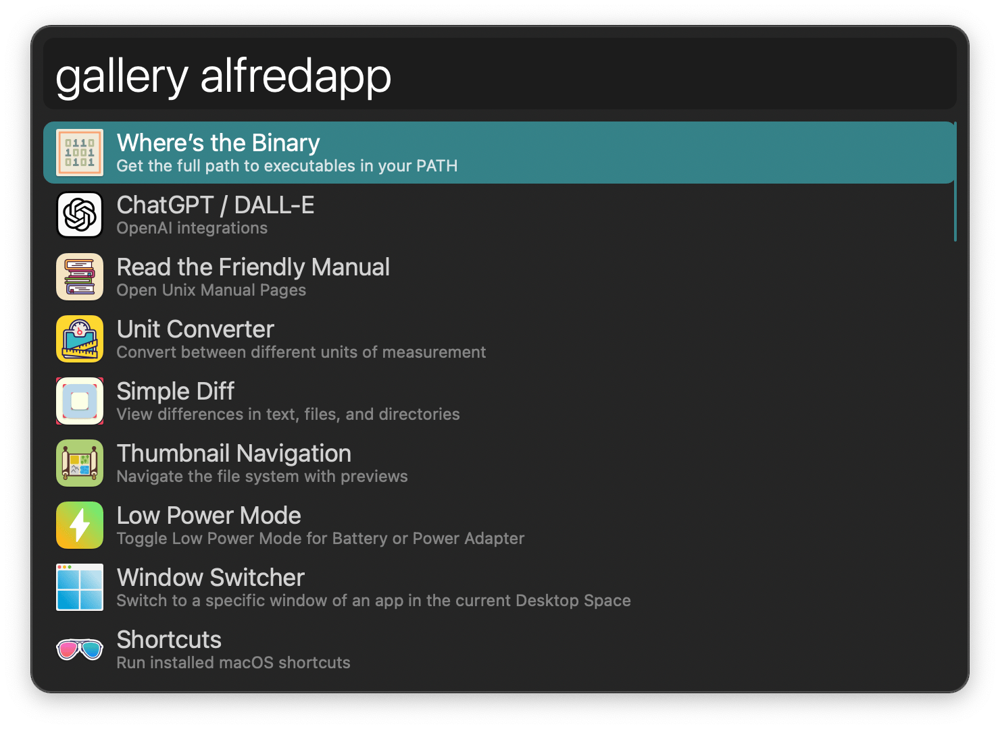
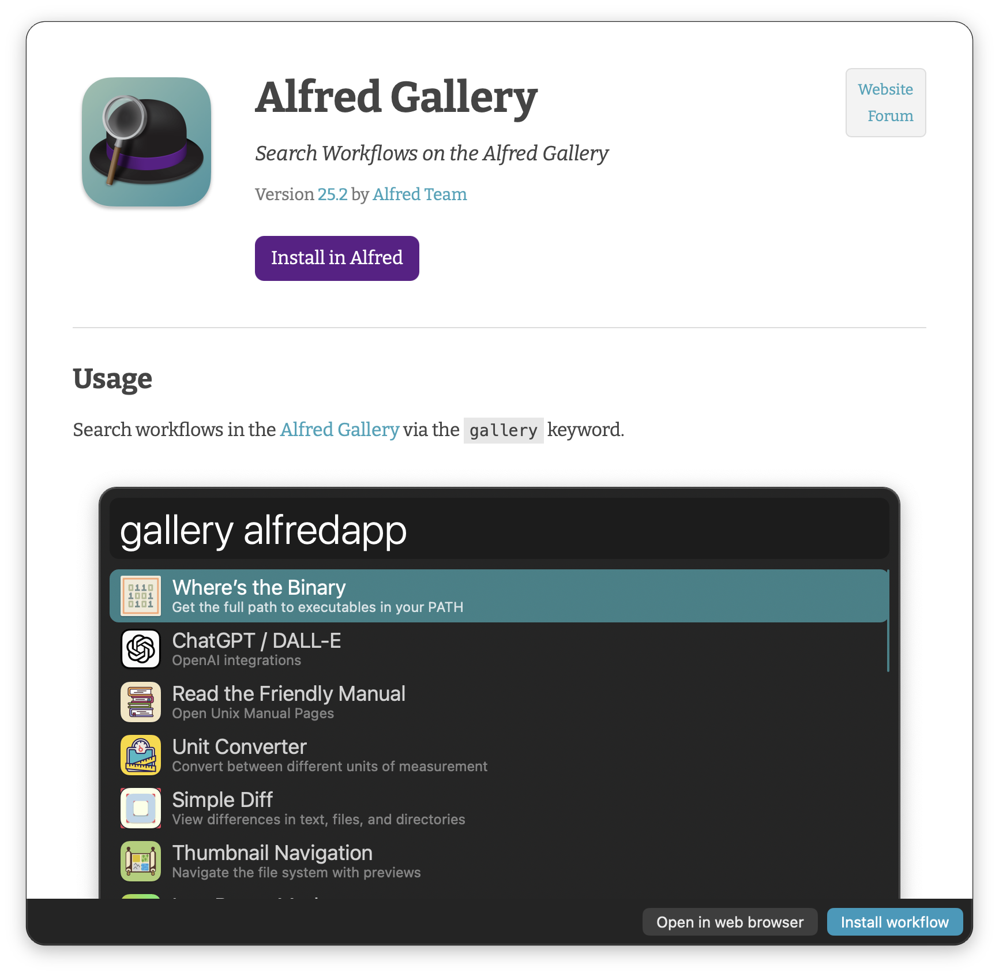

#  Alfred Gallery Alfred Workflow

Search Workflows on the Alfred Gallery

[⤓ Install on the Alfred Gallery](https://alfred.app/workflows/alfredapp/alfred-gallery)

## Usage

Search workflows in the [Alfred Gallery](https://alfred.app/) via the `gallery` keyword.

* <kbd>↩&#xFE0E;</kbd> Open workflow’s Gallery page.
* <kbd>⌃</kbd> Show tags.
* <kbd>⌘</kbd><kbd>↩&#xFE0E;</kbd> Install workflow.
* <kbd>⌥</kbd><kbd>↩&#xFE0E;</kbd> Narrow search to creator’s name.
* <kbd>⇧</kbd><kbd>↩&#xFE0E;</kbd> Paste link to workflow’s Gallery page.
* <kbd>⌘</kbd><kbd>Y</kbd> [Quick Look](https://www.alfredapp.com/help/features/previews/) workflow’s Gallery page.

By default, workflow Gallery pages open in a webview. You can change this in the [Workflow’s Configuration](https://www.alfredapp.com/help/workflows/user-configuration/)

* <kbd>↩&#xFE0E;</kbd> Install workflow.
* <kbd>⌘</kbd><kbd>O</kbd> Open in web browser.
